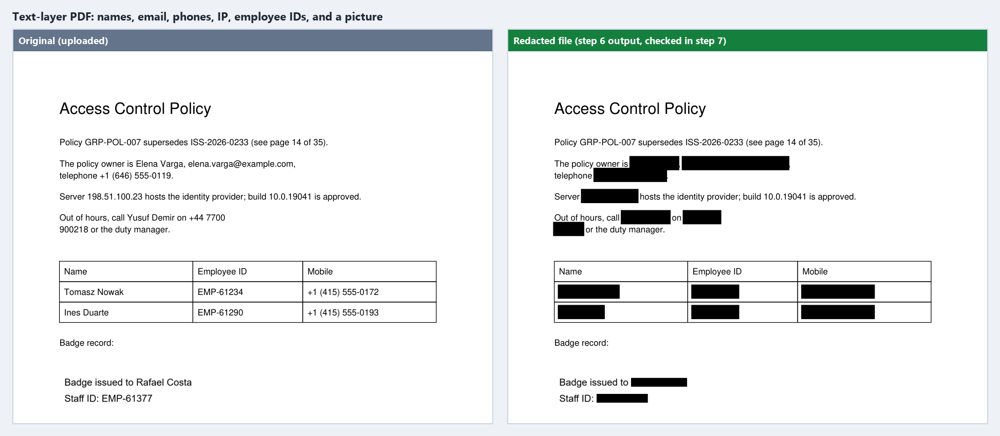
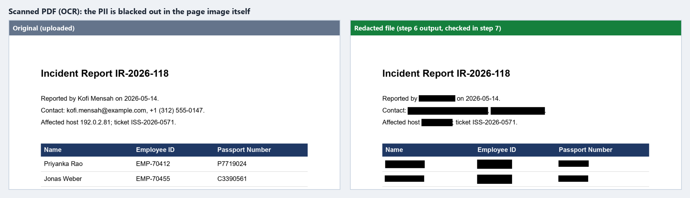
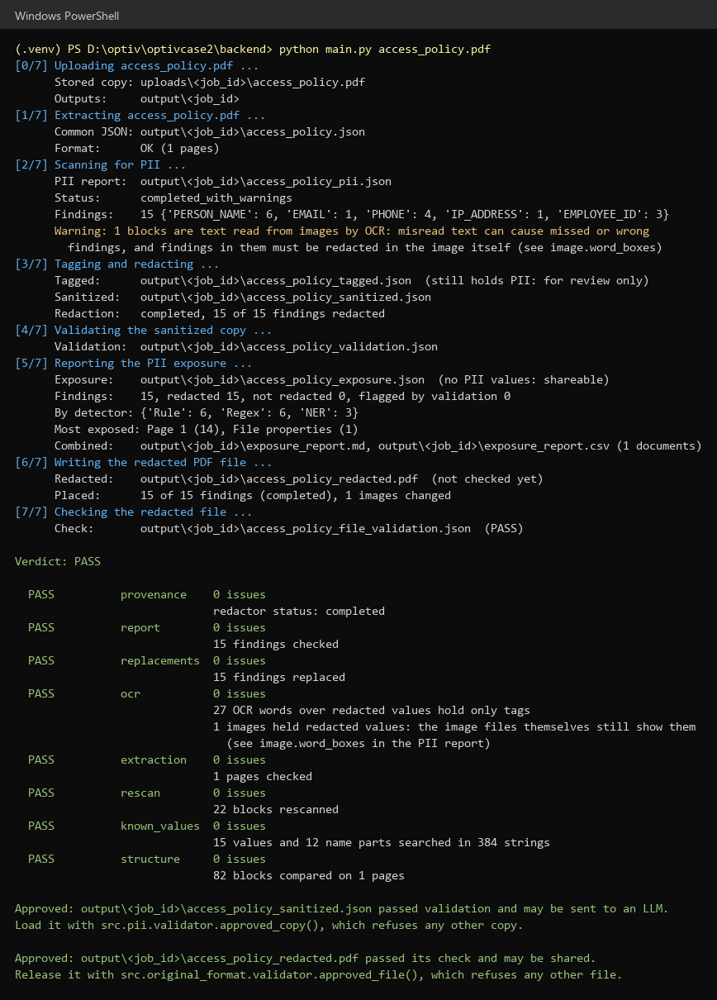
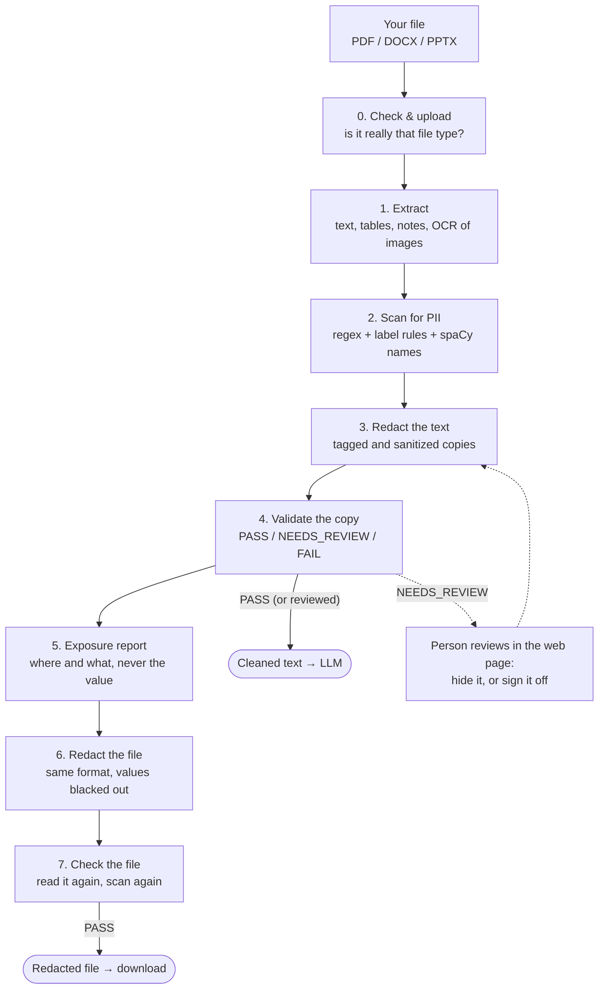

# PIIShield: find and remove personal data from documents

PIIShield takes a **PDF, Word (DOCX) or PowerPoint (PPTX)** file, finds the
personal information in it (names, emails, phone numbers, IDs, addresses and
more), and gives you back:

- a **cleaned text copy** that is safe to send to an AI model (LLM), and
- a **redacted copy of the file itself**, in the same format, with every value
  blacked out.

Both are **checked again** before they are released. Everything runs on your
own computer: no document text is sent to any outside service.



---

## Why I made it

This project is my solution to **Optiv Case Study 02: PII Detection and
Redaction**.

In the case, a financial services firm (Cadence) uses an AI document-analysis
agent to read its business documents. A new policy says **personal data may
not be processed by AI models**. So before any document reaches the LLM,
every piece of PII in it has to be found and removed, and someone has to be
able to prove that was done.

The hard parts, and what this project focuses on:

- **Any format.** The samples were a 35-page *scanned* PDF (only images, no
  text), a PowerPoint pack with org charts and tables, and a Word guide full of
  screenshots. So it has to read text, tables, images (OCR), notes, comments
  and file properties.
- **Don't trust, verify.** Redacting is not enough. The result is scanned again
  and only released if it passes.
- **Show the exposure without showing the data.** The reports say *where* the
  PII was and *what type* it was, never the value itself.
- **Stay local.** Regex rules, a small spaCy language model and Tesseract OCR,
  all on the machine.

---

## See it working

**1. A scanned PDF.** The PII is blacked out in the page image itself, found by OCR.



**2. The cleaned text copy (what the LLM gets).** One block of text from the
document above, in the three versions the pipeline writes:

```text
Original   The policy owner is Elena Varga, elena.varga@example.com, telephone +1 (646) 555-0119.
Tagged     The policy owner is [PERSON_NAME: Elena Varga], [EMAIL: elena.varga@example.com], telephone [PHONE: +1 (646) 555-0119].
Sanitized  The policy owner is [REDACTED: PERSON_NAME], [REDACTED: EMAIL], telephone [REDACTED: PHONE].
```

The *tagged* copy is for reviewers (it still holds PII). Only the *sanitized*
copy may go to the LLM.

**3. A full run from the command line.** Steps 0 to 7, the safety checks, and
the release decision.



*All pictures come from the synthetic test documents in
`evaluation/corpus/synthetic/` (made-up people and numbers). Paths in the
terminal picture are shortened.*

---

## How it works

Every document goes through the same steps. Each step writes one file, and the
next step reads it, so any step can be re-run on its own.



| Step | What happens | Output (in `backend/output/<job_id>/`) |
|---|---|---|
| 0. Check & upload | Refuses empty, renamed, password-protected or damaged files. Stores a copy with its SHA-256. | `backend/uploads/<job_id>/<file>` |
| 1. Extract | Turns any format into **one common JSON**: pages → blocks (heading, paragraph, table, cell, image text…), each with an ID, position and reading order. Scanned pages and pictures are read with OCR. | `<name>.json` |
| 2. Scan | Finds PII in every block and records the exact characters (`block_id` + start/end). | `<name>_pii.json` |
| 3. Redact | Replaces each value at those exact characters with a tag. | `<name>_tagged.json`, `<name>_sanitized.json` |
| 4. Validate | Re-checks the sanitized copy: every value replaced, a fresh scan finds nothing, no known value or name part left anywhere, structure unchanged, OCR trustworthy. | `<name>_validation.json` |
| 5. Report | One row per finding: document, page, block, type, detector, confidence, action. No values. | `<name>_exposure.json`, plus `backend/output/exposure_report.md` and `.csv` over all runs |
| 6. Redact the file | Writes the redacted PDF/DOCX/PPTX from the original: text, tables, notes, comments, charts, image pixels, links, metadata. | `<name>_redacted.<ext>` |
| 7. Check the file | Re-extracts and rescans the redacted file, and searches every part of it for the known values. A failed file is deleted. | `<name>_file_validation.json` |

**The release rule.** The cleaned copy is only handed out by
`approved_copy()`, and the redacted file only by `approved_file()`. They check
that the file is unchanged since it was validated and that the verdict is
PASS (or NEEDS_REVIEW with every issue signed off by a person). A FAIL can
never be released.

### What it detects

| Type | Type | Type |
|---|---|---|
| Person names | Email addresses | Phone numbers |
| Employee IDs | US SSN | Indian PAN |
| Passport numbers | National IDs (e.g. Aadhaar, PESEL) | Dates of birth |
| Home addresses | Payment card numbers | Bank accounts / IBAN |
| IP addresses | | |

It finds them with three detectors that work together:

1. **Patterns (regex)** for values with a fixed shape, plus validity checks
   (Luhn for cards, check digits for IDs, "is this really a phone or a date?").
2. **Labels and context**: a nearby word ("Tel", "SSN", "Passport No.") or the
   table's column header says what a value is.
3. **spaCy NER** for person names in sentences, then filtered (no job titles,
   no street names). Surnames and first names found once are also searched for
   everywhere else in the document.

---

## Components

```text
optivcase2/
├── requirements.txt          Python packages
├── backend/                  ← run everything from here
│   ├── main.py               command line: runs steps 0–7 on one file
│   ├── app.py                web page server (Flask, 127.0.0.1 only)
│   ├── static/               the web page (HTML, CSS, JavaScript)
│   ├── src/
│   │   ├── uploads.py        step 0: store the upload
│   │   ├── extractors/       step 1: PDF, DOCX and PPTX readers
│   │   ├── ocr/              step 1: Tesseract OCR for pictures
│   │   ├── structure/        step 1: PDF tables, headings, headers/footers, columns
│   │   ├── models/           the common JSON format and its check
│   │   ├── pii/              steps 2–5: detect, redact, validate, report, review
│   │   ├── original_format/  steps 6–7: write and check the redacted file
│   │   └── web/              the web page's job runner
│   ├── uploads/              stored uploads (real PII, not in git)
│   └── output/               each run's results (real PII, not in git)
├── evaluation/               labelled synthetic documents and the scoring script
├── archive/                  tests, sample files, phase-1 analysis
├── presentation/             the case-study slide deck
└── docs/                     pictures for this README, and the old detailed guide
```

| Component | What it has |
|---|---|
| **Command line** (`main.py`) | Runs the whole pipeline on one file and prints each step, the checks and the release decision. Exit code: `0` PASS, `1` FAIL or error, `2` needs review. |
| **Web page** (`app.py`, `static/`, `src/web/`) | Upload a file, follow the progress, then tabs for *Original text* (findings highlighted), *What was found*, *Cleaned text* and *Safety check*. Review issues ("Hide it" / "Checked, it's fine") and download the redacted file once it is approved. |
| **Extractors** (`src/extractors/`) | `pdf_extractor.py` (text layer, or OCR for scanned pages), `docx_extractor.py` (paragraphs, tables, headers, footers, comments, notes, text boxes, charts, images), `pptx_extractor.py` (slides, tables, groups, notes, comments, charts, SmartArt, template images). |
| **OCR** (`src/ocr/image_ocr.py`) | Reads pictures with Tesseract and keeps each word's box and confidence, so the right pixels can be blacked out later. |
| **Structure** (`src/structure/`) | Rebuilds tables from scanned pages, marks headings, labels running headers/footers, and reads two-column pages in the right order. |
| **Common format** (`src/models/`) | `document.py` describes the JSON (Document → Page → Block → children); `schema.py` checks every extraction against it. |
| **PII detection** (`src/pii/detectors.py`, `document_scanner.py`) | The regex, label and spaCy detectors, and the scanner that adds table-header context, name widening, surname search and warnings. |
| **Redactor** (`src/pii/redactor.py`) | Writes the tagged and sanitized copies at exact character offsets; overlapping findings merge into one. |
| **Validator** (`src/pii/validator.py`) | Eight checks (provenance, report, replacements, OCR, extraction, rescan, known values, structure), the verdict, and the release gate `approved_copy()`. |
| **Exposure report** (`src/pii/exposure_report.py`) | Per-document and combined Markdown/CSV reports, with a final self-check that no PII value slipped into them. |
| **Review** (`src/pii/review.py`) | Lets a person hide a missed value or sign off an issue, with their name and the time. |
| **Original-format redaction** (`src/original_format/`) | `docx_file.py`, `pptx_file.py`, `pdf_file.py` write the redacted file; `images.py` blacks out image pixels; `validator.py` checks it and holds the release gate `approved_file()`. |
| **Evaluation** (`evaluation/`) | 9 synthetic labelled documents (+3 invalid ones) and `run_evaluation.py`, which scores every step. |
| **Tests** (`archive/tests/`) | Plain Python scripts that print PASS/FAIL per case. |

---

## Run it on your computer

Developed and tested on **Windows 11 with PowerShell** and **Python 3.14**.

### 1. Get the code and install the Python packages

```powershell
git clone https://github.com/kanika10-hub/PIIShield.git
cd PIIShield
python -m venv .venv
.venv\Scripts\Activate.ps1
pip install -r requirements.txt
```

This also downloads the spaCy English model (`en_core_web_sm`).

> If PowerShell says scripts are disabled, run
> `Set-ExecutionPolicy -Scope CurrentUser RemoteSigned` once, then activate again.

### 2. Install Tesseract OCR

Tesseract is a separate program (not a pip package). It reads scanned pages
and pictures.

1. Install it from the [UB Mannheim Tesseract builds](https://github.com/UB-Mannheim/tesseract/wiki).
2. Add `C:\Program Files\Tesseract-OCR` to your `PATH`.
3. Open a new terminal and check: `tesseract --version`

Without Tesseract, scanned PDFs cannot be read at all. Without the spaCy model,
it still runs but finds no person names (it prints a warning).

### 3. Run it

Always run from the `backend` folder:

```powershell
cd backend
```

**Web page**

```powershell
python app.py
```

Open **http://127.0.0.1:5000**, drop in a PDF, Word or PowerPoint file, and
click **Check document**. (Use `python app.py 5050` for another port.)

**Command line**

```powershell
python main.py ..\evaluation\corpus\synthetic\access_policy.pdf   # a safe synthetic test file
python main.py "D:\any\folder\report.docx"                        # any PDF, DOCX or PPTX
python main.py                                                    # opens a file chooser
```

The results are in `backend\output\<job_id>\`. The last lines say whether the
cleaned copy and the redacted file are **Approved** or **Blocked**, and why.

### 4. Check that it works (optional)

```powershell
# still in backend/
$env:PYTHONPATH = "."
python ..\archive\tests\test_redactor.py        # one self-checking test
python ..\evaluation\run_evaluation.py          # scores the whole pipeline on the synthetic documents
```

The evaluation writes its report to `evaluation/results/<timestamp>/summary.md`.

---

## How well it works

Latest evaluation (18 Oct 2026) on the 9 synthetic documents:

| | Result |
|---|---|
| Labelled PII values found | **88 / 88** (precision 1.00, recall 1.00) |
| PII left in a released copy or file | **0** |
| Invalid files (empty, renamed) refused | **3 / 3** |
| Redacted files written, checked and released | **9 / 9** |
| Document structure kept | **152 / 152** elements |

**Limits.** The checks rescan with the same detectors, so a PASS means "no PII
the detectors can see", not a guarantee. OCR can misread text, so noisy scans
usually end as *NEEDS_REVIEW* for a person to check. The test documents are
small and synthetic.

---

## Privacy notes

- `backend/uploads/` and `backend/output/<job_id>/` hold real PII and are not
  committed to git.
- Only the validation and exposure reports, and an **approved** cleaned copy or
  redacted file, are meant to be shared.

## More detail

- [docs/DETAILED_GUIDE.md](docs/DETAILED_GUIDE.md): the earlier, step-by-step
  reference (output formats, glossary, common tasks).
- [evaluation/README.md](evaluation/README.md): how the test documents are
  labelled and scored.
- [presentation/](presentation/): the case-study slide deck.
